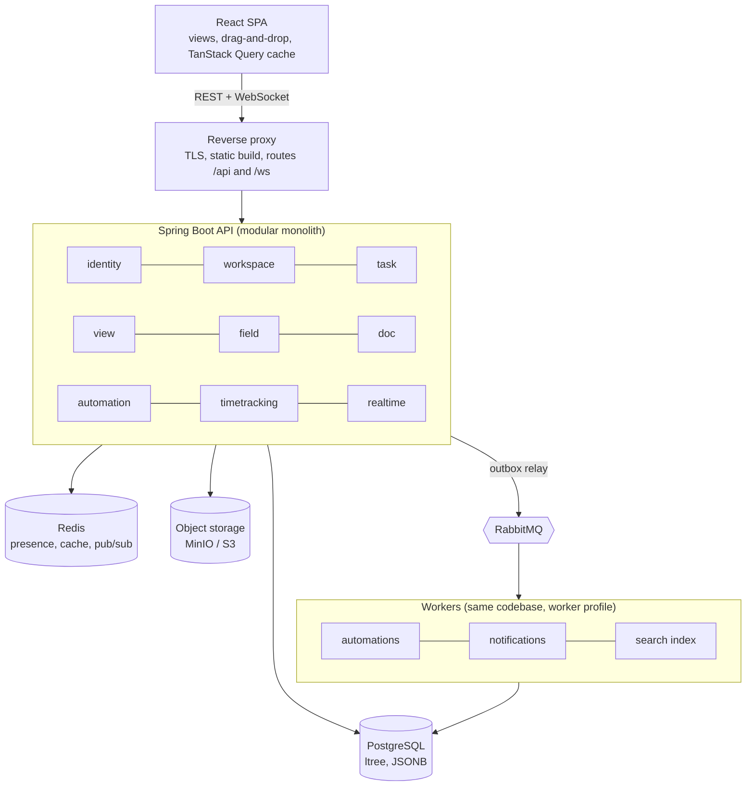
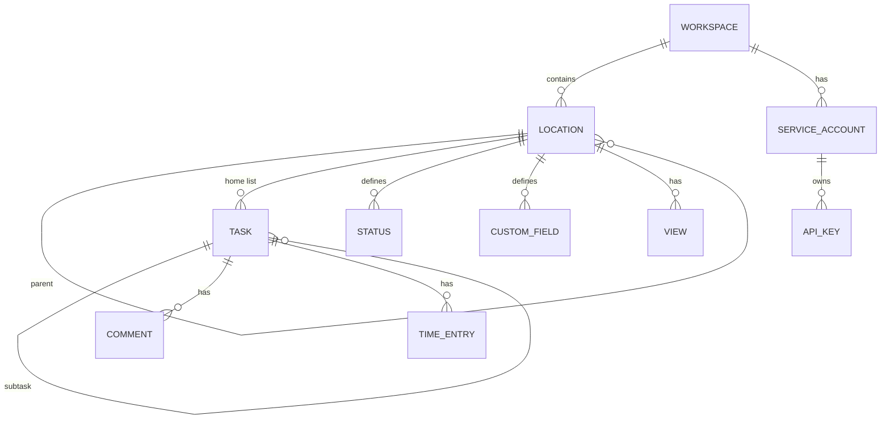

# Taskflow: Architecture

Status: Draft v1 · Pairs with [PRD.md](PRD.md). Requirement IDs (for example `TASK-6`) refer to the PRD.

## 1. Overview

Taskflow is one Spring Boot application with strict module boundaries (a modular monolith), plus background workers behind a message broker. The React app talks only to the API over REST and WebSocket. Microservices would add network failures and deployment overhead without helping a project this size. Split a module into its own service only if it needs to scale on its own.



## 2. Tech stack

| Layer | Choice |
| --- | --- |
| Frontend | React, TypeScript, Vite, TanStack Query, TanStack Table, TanStack Virtual, Zustand, dnd-kit, Tiptap, React Hook Form, Zod, React Router |
| Backend | Java 21, Spring Boot 3, Spring Security, Spring Data JPA (writes), jOOQ (view queries), Flyway, Spring Modulith, springdoc OpenAPI |
| Data | PostgreSQL (with `ltree` and JSONB), Redis, RabbitMQ, MinIO (S3-compatible) |
| Tests | JUnit 5, Testcontainers, Vitest, Testing Library, Playwright, k6 |
| Delivery | Docker Compose locally, GitHub Actions CI, one container image with `api` and `worker` profiles |

## 3. Repository layout

```
backend/    Spring Boot app (Maven or Gradle), packages per module
frontend/   React app (Vite)
docs/       PRD, architecture, decisions
deploy/     Docker Compose, Dockerfiles, deployment config (added in phase 1)
```

## 4. Backend modules

Package root: `com.taskflow`. Each module owns its tables and exposes a small public API. Modules talk through that API or through events, never through another module's internals. Spring Modulith verifies this in a test.

| Module | Responsibility |
| --- | --- |
| `identity` | Users, authentication, JWT and refresh tokens, roles, service accounts, API keys, permission evaluation |
| `workspace` | Workspaces, members, invites, the Space/Folder/List tree (`location`), private-location grants |
| `task` | Tasks, subtasks, checklists, assignees, tags, dependencies, comments, activity, trash, ranking |
| `view` | Saved views and the query compiler that turns a view config into SQL |
| `field` | Statuses and custom fields: definitions, inheritance, validation, value serialization |
| `doc` | Docs and nested pages |
| `automation` | Rule storage, trigger matching, action execution, scheduler |
| `timetracking` | Time entries, estimates, timesheets |
| `realtime` | STOMP gateway, topic permission checks, presence |
| `shared` | Outbox, event types, error handling, pagination, rate limiting |

## 5. Data model

Every table carries `workspace_id` for tenant isolation.



| Table | Key columns | Notes |
| --- | --- | --- |
| `workspace`, `workspace_member` | id, name; user_id, role | Roles: owner, admin, member, guest |
| `location` | id, workspace_id, parent_id, type (SPACE, FOLDER, LIST), name, path, is_private | `path` is a Postgres `ltree`, so "everything under this Space" is one indexed query |
| `status` | id, location_id, name, group, color, position | A location defines its own or inherits from the nearest ancestor that does |
| `task` | id, list_id, parent_task_id, status_id, title, description, priority, start_date, due_date, rank, custom (jsonb), version, deleted_at, created_by | `list_id` is the home List. `rank` is a fractional-index string. `version` is for optimistic locking |
| `task_list_link` | task_id, list_id | Lets a task also appear in other Lists (later) |
| `task_assignee`, `task_tag`, `checklist`, `checklist_item` | task_id, user_id and similar | Join and child tables |
| `task_dependency` | task_id, depends_on_id, type | Cycle check on write |
| `custom_field` | id, location_id, name, type, config (jsonb) | Applies to every task under the location. Values live in `task.custom`, keyed by field id |
| `view` | id, location_id, type, name, config (jsonb), owner_id, visibility | `config` holds scope, filters, grouping, sort, columns |
| `comment` | id, task_id, author_id, body (json), parent_id | Mentions parsed into a join table |
| `time_entry` | id, task_id, user_id, started_at, duration, billable | Timer and manual entries |
| `automation` | id, location_id, trigger, conditions (jsonb), actions (jsonb), enabled | Evaluated by the automation worker |
| `doc`, `doc_page` | id, location_id; doc_id, parent_page_id, content (json) | Page tree |
| `service_account` | id, workspace_id, name, disabled | Non-human identity, full access |
| `api_key` | id, service_account_id, name, prefix, hash, last4, expires_at, last_used_at, revoked_at | Only the hash is stored |
| `activity_event` | id, workspace_id, entity, entity_id, type, payload, actor_type, actor_id, created_at | Feeds the activity log. `actor_type` is USER, SERVICE_ACCOUNT or AUTOMATION |
| `outbox_event` | id, type, payload, created_at, published_at | Written in the same transaction as the change |

## 6. Key design decisions

1. **One self-referencing `location` table with `ltree`.** A view scoped to a Space needs every task in every List below it. The path makes that a single indexed lookup instead of a recursive query.
2. **Views are saved queries.** One compiler turns a view config into SQL. Several renderers draw the result.
3. **Fractional indexing for order.** Store a short string rank per task, so dragging a card between two others updates one row. Re-rank a column only when the strings run out of room.
4. **Custom field values as JSONB on the task.** Filtering and sorting on a field is one query with an expression or GIN index, with no join per field. Definitions stay relational so they can be inherited and validated.
5. **Outbox for events.** The activity event and the outbox row are written in the same transaction as the change. A relay then publishes them. That avoids lost or duplicated notifications and automation runs.
6. **jOOQ for reads, JPA for writes.** Dynamic filters and `ltree` operators are awkward in JPA.
7. **Optimistic locking on tasks** (`@Version`). A stale write returns 409 with the current task.
8. **Service-account keys with full access, like ClickUp's API key, but not tied to a person.** See section 9.

## 7. Backend design

### Permissions

> Phase 1 deviates from this section: the evaluator lives in `workspace` (not `identity`), `RankService` is in `shared`, and jOOQ arrives in phase 2. See [decision 002](decisions/002-phase1-core-backend.md).

A user has a workspace role. Private Spaces, Folders and Lists add explicit grants. A custom `PermissionEvaluator` resolves the effective permission by walking the `path` up to the nearest grant, and is called from `@PreAuthorize("@perm.canEdit(#taskId)")`. Cache the result per request. A service account is treated as a workspace admin by the same evaluator.

### View query engine

A view's `config` (scope, filters with AND/OR groups, grouping, sort, columns) compiles into one SQL query with jOOQ. Scope is `path <@ :locationPath`. Pagination is keyset on the sort keys plus `id`, never offset, so a 5,000-task List stays fast.

### Custom fields and statuses

The effective fields of a List are its own plus those of every ancestor. A `FieldType` strategy per type validates and serializes values into `task.custom`. Index hot fields with expression indexes. Statuses resolve by walking up to the nearest location that defines them.

### Ordering

A `RankService` returns a rank between two neighbours. The move endpoint takes `beforeId` or `afterId` plus the target status, and the server computes the rank, so clients cannot corrupt order.

### Automations

A rule is a trigger (task created, status changed, field changed, due date approaching), optional conditions, and actions (set status, assign, comment, notify). The worker loads rules whose location is an ancestor of the task, evaluates them, and runs actions through the normal service layer as a system actor. Each event carries the id of the automation that caused it, so a rule cannot trigger itself in a loop. Time-based triggers run from a scheduler guarded by ShedLock.

### Search

PostgreSQL full-text search with a generated `tsvector` column on title and description. Move to OpenSearch only if relevance becomes a problem.

## 8. Events, real-time and async

1. **Write.** A service updates the task and inserts an `outbox_event` (for example `task.status_changed`) in one transaction.
2. **Relay.** A relay reads unpublished outbox rows with `FOR UPDATE SKIP LOCKED`, publishes them to RabbitMQ and to Redis pub/sub, and marks them sent. A crash between publish and mark can duplicate an event, so every consumer is idempotent.
3. **Live UI.** Each API instance subscribes to Redis and forwards events to its connected browsers over STOMP, on topics such as `/topic/location/{id}` and `/topic/task/{id}`. Redis lets several API instances share one real-time layer.
4. **Workers.** The automation, notification and search workers consume from RabbitMQ queues. Failed messages retry with backoff, then land in a dead-letter queue.
5. **Activity feed.** The same events are written to `activity_event`.

Browsers receive only events they are allowed to see, so the subscription handler checks permission before joining a topic. Events carry the task version, so a client can ignore a stale message that arrives after a newer one.

## 9. API, service-account keys and MCP

### REST conventions

- Versioned under `/api/v1`. JSON bodies. Errors as `application/problem+json`. OpenAPI generated with springdoc, and the frontend client is generated from it.
- Keyset pagination with an opaque `cursor`.
- Updates send `If-Match` with the task version. A stale write returns 409.
- `Idempotency-Key` header on creates, so an agent retry does not create duplicates.

| Resource | Endpoints |
| --- | --- |
| Hierarchy | `GET /workspaces/{id}/tree`, `POST /locations`, `PATCH /locations/{id}` |
| Tasks | `GET /tasks?view=...`, `POST /lists/{id}/tasks`, `GET /tasks/{id}`, `PATCH /tasks/{id}`, `POST /tasks/{id}/move`, `DELETE /tasks/{id}` |
| Views | `GET /locations/{id}/views`, `POST /views`, `GET /views/{id}/tasks` |
| Comments and time | `GET` and `POST /tasks/{id}/comments`, `POST /tasks/{id}/time-entries` |
| Service accounts and keys | `GET` and `POST /workspaces/{id}/service-accounts`, `GET` and `PATCH .../{id}`, `POST .../{id}/disable` and `/enable`, `GET` and `POST .../{id}/api-keys`, `DELETE .../{id}/api-keys/{keyId}`, `GET .../{id}/audit` and `/activity` (people only) |

### Service accounts and API keys

- A service account is a workspace-level identity with no password, created by an admin (for example `ci-bot` or `triage-agent`). It has full access to the workspace, the same as an admin.
- Each service account can hold several API keys. A key is shown once and prefixed `tf_sk_`. The server stores only a SHA-256 hash, the prefix and the last four characters, plus name, expiry, last-used time and revoked flag.
- A key carries the full access of its service account. There are no per-key scopes.
- Authentication filter: read `Authorization`. If the value is `Bearer <key>` or a raw key starting with `tf_sk_`, hash it, look it up, check it is not revoked or expired and that the service account is not disabled, then build an authentication whose principal is the service account.
- Every change is logged with the service account and the key as the actor, so the feed reads "changed by triage-agent (key CI-1)".
- Rate limit per key per minute with a Redis fixed one-minute window (see [decision 005](decisions/005-agent-access.md)). Responses carry `X-RateLimit-Limit`, `X-RateLimit-Remaining` and `X-RateLimit-Reset`. Exceeding the limit returns HTTP 429 with `Retry-After`. The default is 100 per minute, set per plan in `taskflow.api-keys.rate-limit.plans`. There is no daily cap.
- A default expiry such as 90 days, and one switch for an admin to disable a service account and cut off all its keys at once.

### MCP server

- An MCP endpoint at `/api/v1/mcp` inside the API (the MCP Java SDK, stateless streamable HTTP, service-account keys only) exposes `search_tasks`, `get_task`, `create_task`, `update_task`, `move_task`, `delete_task`, `add_comment`, `list_locations` and `list_views`.
- Each tool is a thin wrapper over an existing service method, authenticated by the same API key, so there is no second code path to secure.
- REST and MCP calls from a key share one per-minute limit.
- The key goes in the agent's MCP configuration or an environment variable, not in a chat prompt.
- `delete_task` moves the ticket to a 30-day trash.
- Ticket text is untrusted input. A full-access agent that follows a malicious comment can do real damage, so keep human review of destructive steps in the agent's own tooling and rely on the trash and audit trail to recover.
- Later: a hosted OAuth flow so agents get a key after a user approves a consent screen.

## 10. Frontend design

One view renderer takes a view config and a task query, and draws List, Board, Table or Calendar from the same data. That keeps adding a new view cheap.

- **Structure.** Feature folders (`auth`, `workspace`, `tasks`, `views`, `fields`, `docs`, `time`, `automations`) over a shared `ui` library and a generated API client. Types come from the backend's OpenAPI spec through `openapi-typescript`, so the contract cannot drift.
- **State.** TanStack Query owns server data, with query keys built from the location and the view config. Zustand holds UI-only state such as the open task, selection and sidebar. Filters, grouping and sort live in the URL.
- **Sidebar.** A lazily loaded tree of Spaces, Folders and Lists. Children load on expand, and expansion state persists locally.
- **Views.** A `ViewRenderer` switches on `view.type` and reads tasks through one `useViewTasks(view)` infinite query that follows the server's keyset cursors. List is virtualized with TanStack Virtual. Board uses dnd-kit with per-column paging. Table uses TanStack Table with inline editors. Calendar queries by date range.
- **Custom field registry.** A map from field type to `{ Cell, Editor, FilterInput }`, mirroring the backend's `FieldType` strategies. Adding a type means one entry on each side.
- **Task detail.** A route (`/t/:taskId`) that opens as a side panel over any view, so every task deep-links.
- **Optimistic updates.** A drag updates the cache first, sends the move request, and rolls back on error or a 409. Each client tags its requests with a `clientId`, so the WebSocket echo of its own change is ignored.
- **Real-time.** A STOMP client subscribes to the current location's topic and patches or invalidates matching queries. Presence uses the same channel.
- **Editor and forms.** Tiptap for descriptions, comments and docs, with mentions. React Hook Form with Zod for forms.

## 11. Infrastructure and delivery

- **Local.** Docker Compose runs the API, a worker, PostgreSQL, Redis, RabbitMQ, MinIO and a local mail catcher. A seed script creates a demo Workspace with realistic Spaces, Lists, tasks, a service account and an API key.
- **Hosting.** One container image with two profiles (`api` and `worker`). A single small VM or a managed container service is enough for the demo.
- **CI/CD.** GitHub Actions runs lint, tests and a build on every push, then publishes the image and deploys on merge to `main`. Flyway applies migrations at startup.
- **Observability.** Structured JSON logs with a request id, Micrometer metrics, Spring Boot Actuator health checks. OpenTelemetry tracing across the API, broker and workers if time allows.
- **Security basics.** Passwords hashed with Argon2 or bcrypt, short-lived access tokens with refresh rotation, rate limiting on sign-in and on every API key, CORS locked to the app origin, dependency scanning in CI.

## 12. Testing strategy

| Level | What | Tools |
| --- | --- | --- |
| Unit | Rank service, permission resolution, view query compiler, field validation | JUnit 5, Vitest |
| Integration | Migrations, outbox relay, automations, MCP tools, API key auth, on real PostgreSQL, Redis and RabbitMQ | Testcontainers |
| Concurrency | Parallel moves and edits on one task, optimistic locking | JUnit 5 |
| Module boundaries | No module imports another's internals | Spring Modulith |
| End to end | Sign-in, Board drag-and-drop, two-browser real-time update | Playwright |
| Load | 5,000-task List plus concurrent edits | k6 |

## 13. Build order

Follow the PRD phases. Inside each phase, build vertically (database, API, UI, tests) one requirement at a time.

1. **Phase 1:** repo tooling and Compose, auth, workspaces and the location tree, tasks, statuses, comments and activity.
2. **Phase 2:** view compiler and saved views, List, Board, Table, Calendar, real-time and presence, search. Then deploy and seed (Gate 1).
3. **Phase 3:** custom fields, dependencies, automations, notifications, service accounts, API keys, MCP server (Gate 2).
4. **Phase 4:** Gantt, Timeline, Workload, time tracking.
5. **Phase 5:** Docs, dashboards, forms, digests.
