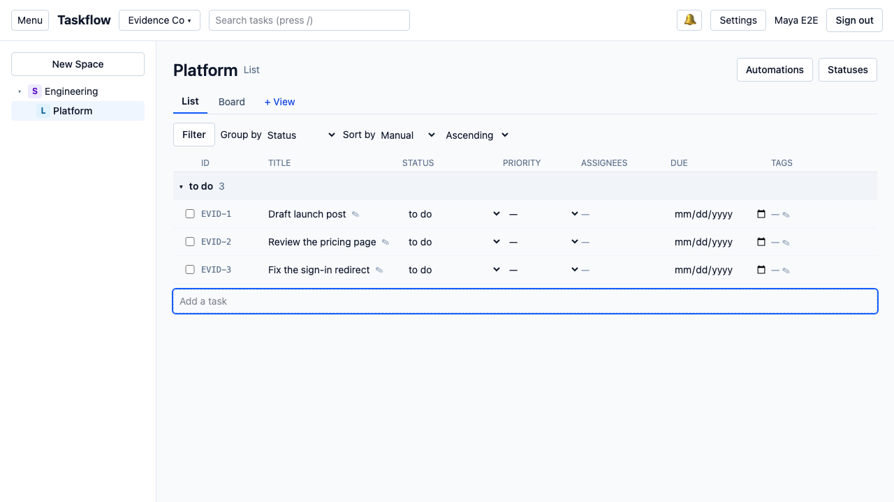
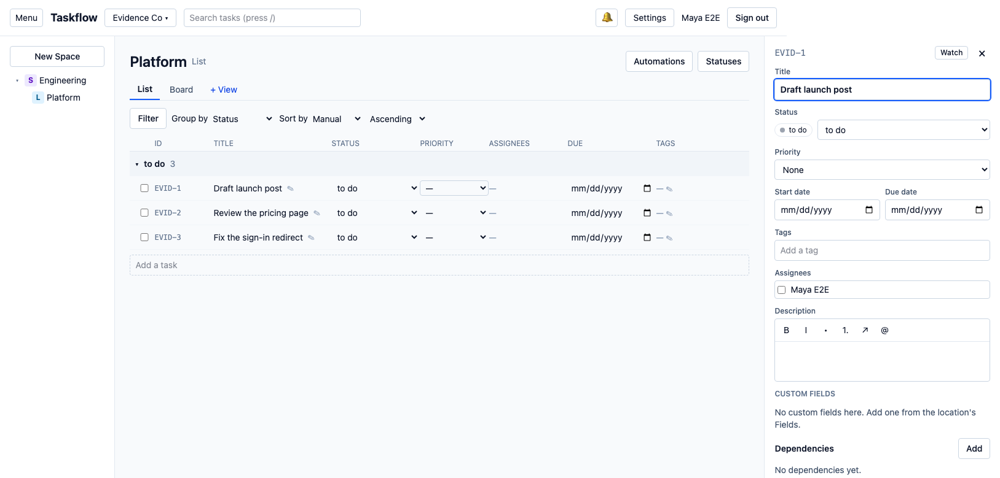
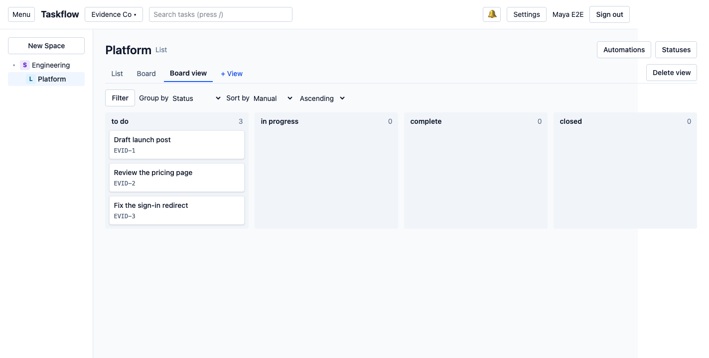
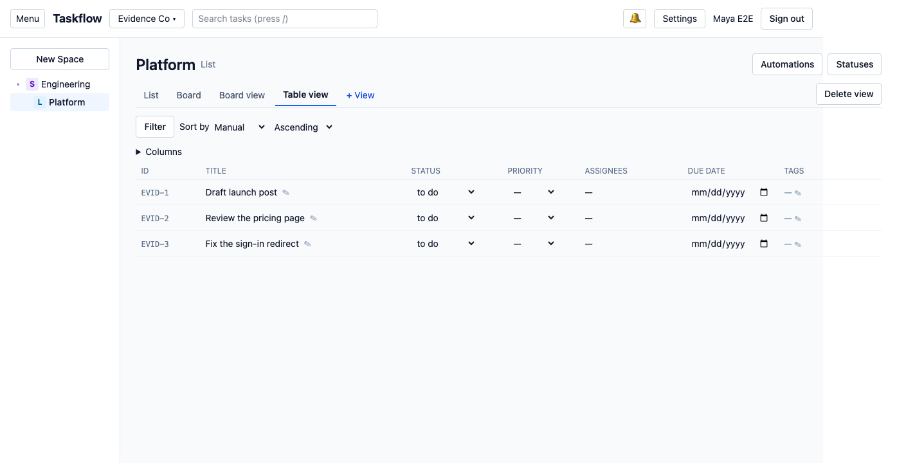
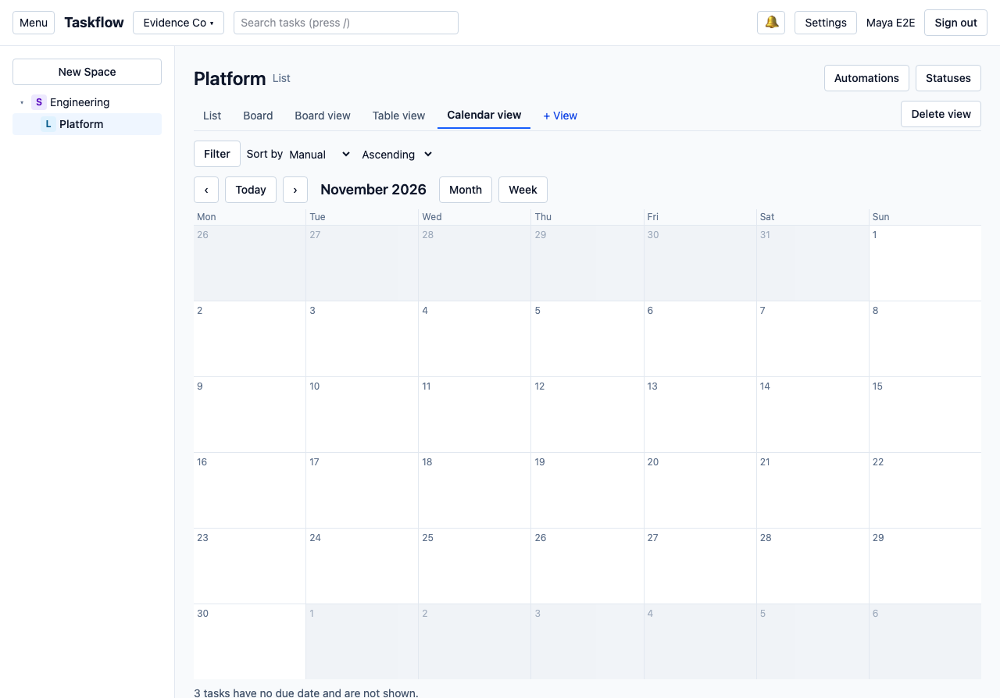
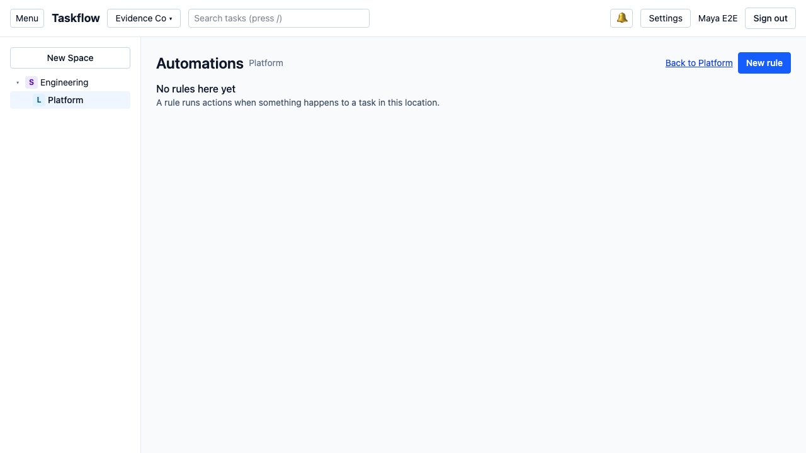
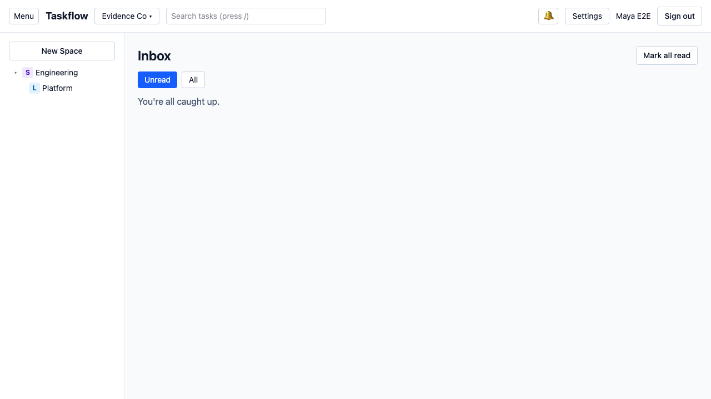
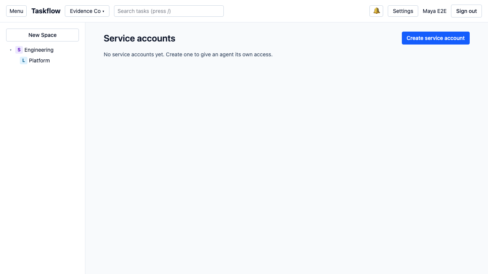

# Slice 1 report: test interaction helper and evidence tooling

Slice 1 changes no product code, API or schema. It adds the select/popover interaction helpers for Playwright
(`frontend/e2e/ui.ts`) and Vitest (`frontend/src/test/ui.ts`), moves every test select site onto them, adds ESLint
guards against direct native-select calls in tests, and adds the evidence tooling (`e2e/theme-screens.spec.ts`,
`scripts/bundle-size.sh`).

## Bundle size (baseline)
`bash scripts/bundle-size.sh`, fresh run: `Bundle size (gzip, dist/assets): 388.1 KiB -> 388.1 KiB (0.0 KiB)`.
Slice 1 sets the bundle baseline: 388.1 KiB gzip. It is report-only here; from slice 2 on a +15% cap over this
baseline per slice fails CI (self-hosted fonts are measured separately).

## Native-select exceptions
The only named exception is `frontend/src/features/views/FilterBuilder.test.tsx` (the `optgroup` read of the
"Filter field" picker). It keeps depending on native selects until FilterBuilder is rebuilt in slice 4
(`TODO(slice 4)` in the test). All 41 product `<select>` elements stay native until their own slices (4 to 9).

## Screenshots (light | dark)
Regenerate with `bash scripts/e2e-local.sh e2e/theme-screens.spec.ts`; they land in `artifacts/screenshots/`
(git-ignored) and the set below is committed here. Both themes look the same in slice 1 because the dark tokens
arrive in slice 2; the set is the "before" for the later slices.

| Screen | Light | Dark |
|---|---|---|
| List view |  |  |
| Task panel |  |  |
| Board |  |  |
| Table |  |  |
| Calendar |  |  |
| Automations |  |  |
| Inbox |  |  |
| Service accounts |  |  |
