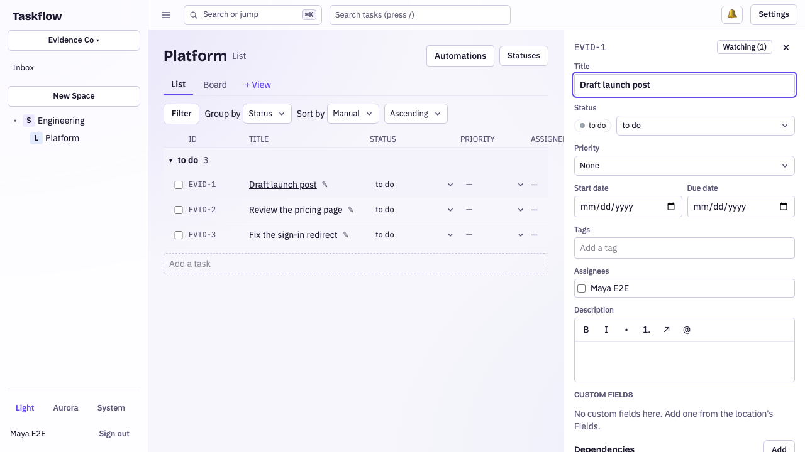
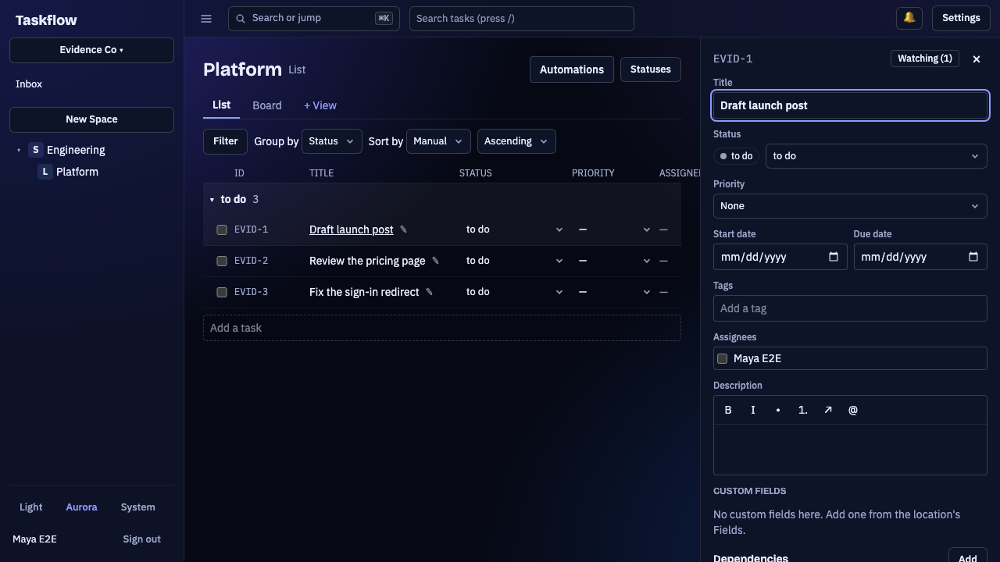
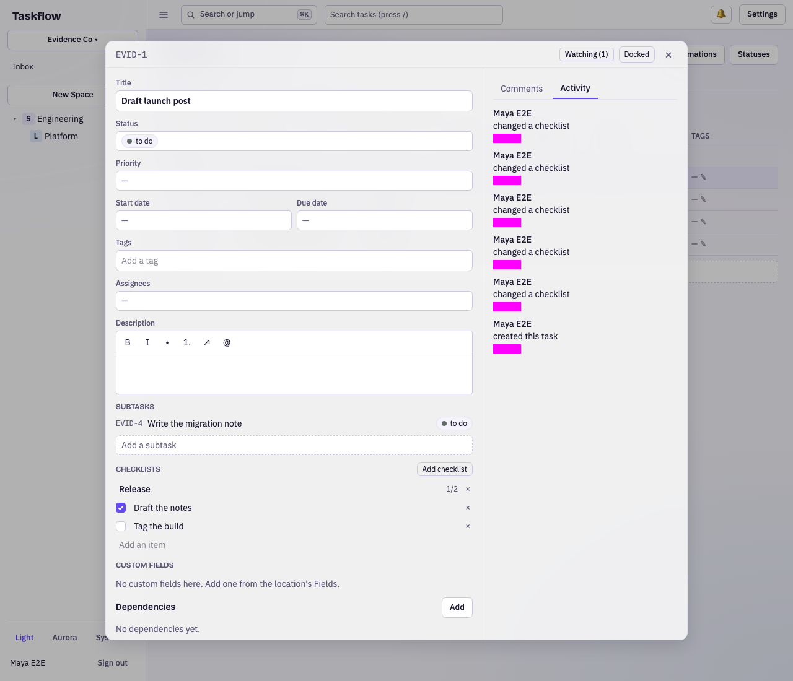
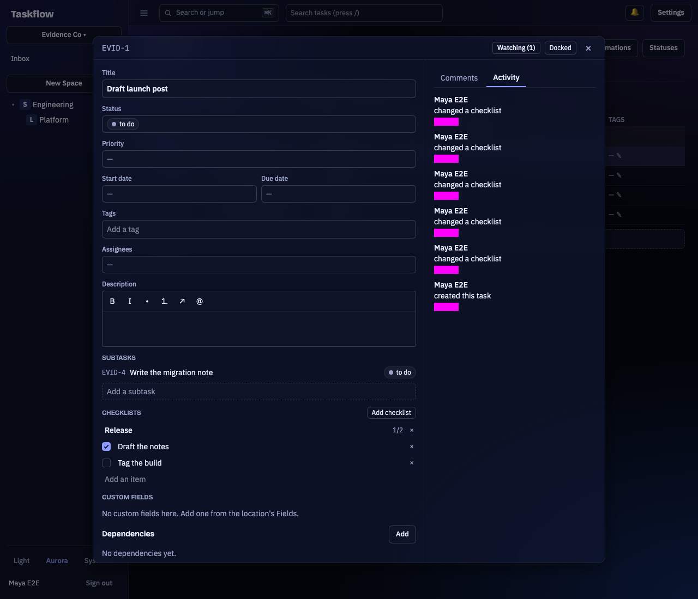
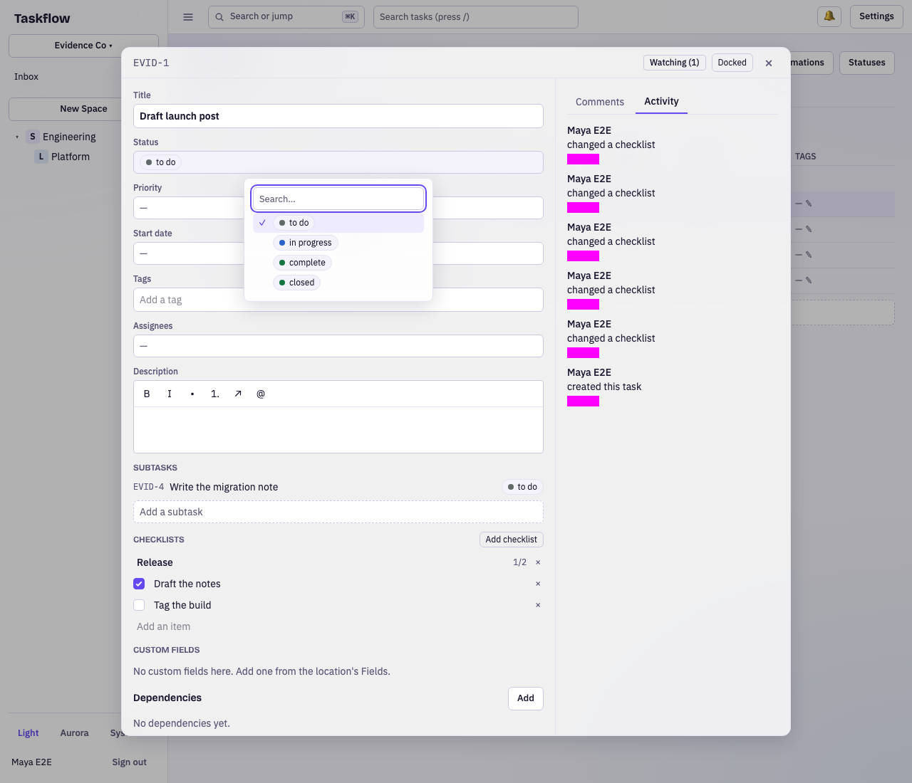
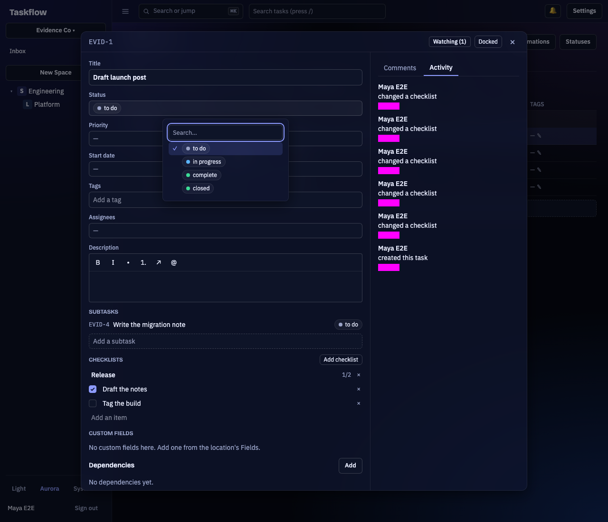
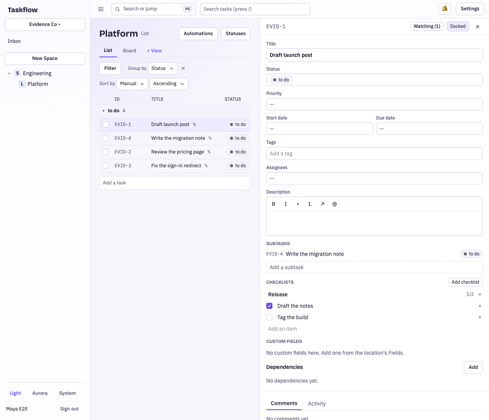
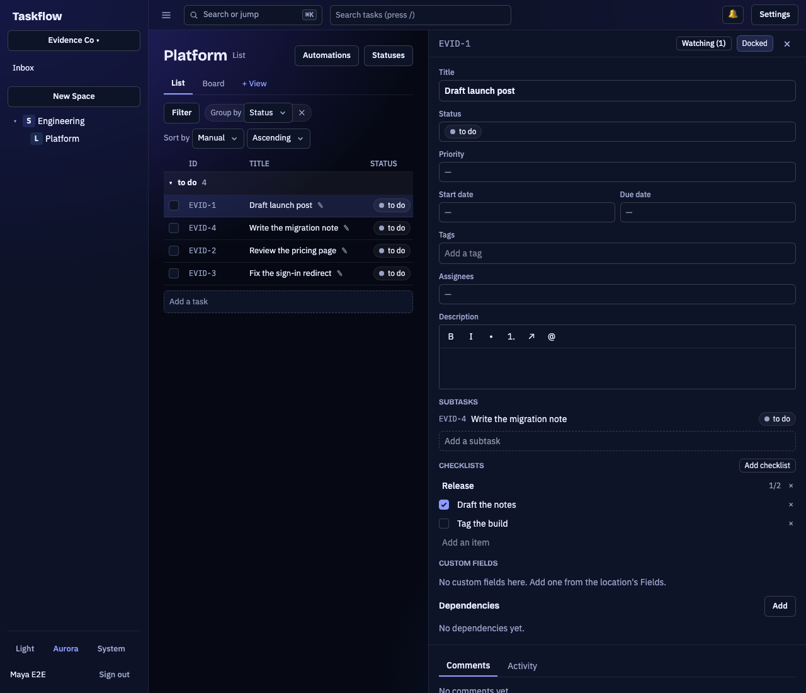

# Slice 5 report: the task detail (modal and docked)

Slice 5 changes `frontend/`, `scripts/` and `docs/ui/` only: no API, no schema, no backend file, no new dependency. It
rebuilds the task detail (UI-PRD section 8, the item after "list") as one body in two frames, moves its fields onto the
slice-4 `Picker`, adds Subtasks, Checklists and j/k between tasks, and closes the five slice-4 carry-overs.

## What changed
- **Carry-overs (S1 to S4)**, see the table below.
- **Editor vocabulary and library (S5).** `features/tasks/editorItems.tsx` holds the status, priority, assignee and day items
  and the trigger values; `views/ListEditors.tsx` imports them back and `views/quickDays.ts` is gone, so no item list exists
  twice. `Dialog` gains `size="task"` (940px, 88vh, no inner padding, hidden title), `initialFocus` and `closeOnEscape`
  (returning false leaves that Escape alone). `isShortcutBlocked` gains `host`: the dialog that hosts the shortcut is not busy,
  every other modal still is. `/design` shows the task-size dialog.
- **Frames (S6).** `TaskPanel` is a frame plus `TaskDetailBody`. Modal: a library `Dialog` named `Task <id>`, fields on the
  left, a 330px "Discussion and activity" column (presence, watch, Comments/Activity) on the right. Docked: a 600px
  `complementary` panel beside the List. A `Docked` toggle (`aria-pressed`) switches; the choice is read from and written to
  `localStorage['taskflow:task-detail']` in try/catch (unknown value or unreadable storage means the modal). A task switch
  swaps only the body and focuses the frame. Escape and Close return focus to the row of the task last shown. Escape inside a
  rich-text editor (composer, a comment being edited, the description) never closes the detail; text fields that hold a draft
  stop Escape themselves. Unsaved description text is flushed when the body goes away. Skeleton, "This task is gone or you
  can't see it." (403/404) and the server message with Retry are shared by both frames. Every complementary locator in the
  e2e and Vitest suites goes through `taskDetail(page)` / `findTaskDetail()`.
- **Fields (S7).** Status, Priority, Assignees, Start date and Due date are `Picker` triggers named by their label (dates:
  Today, Tomorrow, Next week, No date and a day field in the Picker footer, sent as `YYYY-MM-DDT00:00:00Z`). The `Select`, the
  native date inputs and the assignee checkbox list are gone; every edit still goes through `save()`/`guardedSave()`.
- **Dependencies and activity (S8).** Dependencies, Comments, Activity, Presence and the watch control on tokens; Comments and
  Activity gain a Retry on a failed load; each section has a loading, empty and error-with-Retry Vitest case.
- **Subtasks (S9).** The children of the open task from one capped scan of the home List (10 pages of 200, archived Lists
  included) cached under `['subtasks', listId]` (own prefix, 60 s stale time, no refetch on focus). `taskCaches` patches the
  scan on every task write, the trash path invalidates every scan, and the realtime patcher invalidates one List's scan only
  for a task unknown to the tab (not for `comment.*`, not without a `listId`), debounced per List. "Add a subtask" (Enter),
  "Subtask of <id> <title>" link, "Subtask of a task you can't see", capped notice. `useCreateTask` takes a title and an
  optional parent.
- **Checklists (S10).** `useChecklists` over the existing endpoints: each write's whole `ChecklistView` replaces that
  checklist, writes on one checklist are serialized, a refusal restores the previous entry and shows the server message.
  Add, rename, delete, items add/check/edit/delete, done/total, guests read-only.
- **j/k (S11).** `shared/task-order.ts` carries the List's display order; the frame handles j/ArrowDown and k/ArrowUp through
  `isShortcutBlocked(event, { host })` with `replace` navigation, stops at the ends, and does nothing in a text field, with a
  floating layer or the Complete anyway dialog open, or behind a Board/Table/Calendar. The shortcut sheet lists them under
  "Task".
- **Tokens (S12).** The detail's files join `tokens-only.test.ts`.

## Bundle size
`bash scripts/bundle-size.sh --check` after a fresh `npm run build`. Slice 4 ended at 441.1 KiB.

| After | JS/CSS (gzip -9) | Delta |
|---|---|---|
| Slice 4 | 441.1 KiB | |
| S1 to S5 (Picker, palette, e2e script, row-key e2e, vocabulary and library) | 441.4 KiB | +0.3 |
| S6 Frames | 442.1 KiB | +0.7 |
| S7 Fields on Pickers | 442.7 KiB | +0.6 |
| S8 Dependencies and activity restyle | 442.8 KiB | +0.1 |
| S9 Subtasks | 443.5 KiB | +0.7 |
| S10 Checklists | 444.8 KiB | +1.3 |
| S11 j/k | 445.0 KiB | +0.2 |
| S12, S13 (tests, specs and docs only) | 445.0 KiB | +0.0 |

Result: `bundle-size: ok`, **445.0 of 446.3 KiB**, 1.3 KiB left; +3.9 KiB over slice 4. Fonts (raw, not in the cap) 289.0 KiB.
`frontend/bundle-budget.json` is unchanged; nothing was re-baselined. The next slice starts with very little room: the
Board, Table and Calendar rebuilds should delete the code they replace first.

## Contrast
axe `color-contrast`, zero violations, in Light and Aurora and under both OS schemes on the task modal (a subtask, a
checklist, the Activity tab), the Status Picker open over it and the docked panel, and under System-dark on the same three
screens. No token changed.

## Screenshots (before | after)
`bash scripts/e2e-local.sh e2e/theme-screens.spec.ts` (theme seeded through `taskflow:theme`). Before is the committed slice-3
task panel (the slice-4 spec did not change it).

| Screen | Light | Dark (Aurora) |
|---|---|---|
| Task panel, before |  |  |
| Task modal, after |  |  |
| Status Picker open |  |  |
| Task docked beside the List |  |  |

## Carry-overs from slice 4
| Carry-over | Status |
|---|---|
| Picker single mode: mark the option holding the value | Fixed (S1): every option has `aria-checked`, `true` for current values; `Picker.test.tsx` |
| Picker search matched the raw UUID | Fixed (S1): the filter scores the label and optional `keywords` only; a hex fragment of an id shows "No match" |
| Row-key guard cases only in Vitest | Done (S4): `e2e/list.spec.ts` has the modal-dialog, floating-layer and held-Backspace cases (keys dispatched on a row, real auto-repeat) |
| Command palette race | Fixed (S2), root cause below |
| Flaky e2e evidence | Done (S3): `scripts/e2e-local.sh` copies the trace and screenshot of every failed or flaky attempt to `artifacts/e2e-failures/<run>/` and lists them; `retries` unchanged |

**Palette root cause.** The Ctrl/Cmd+K listener was mounted with `AppShell` (inside `CommandPalette`), so a key pressed while the
app was still restoring its session ("Loading Taskflow…") reached nobody, and a command picked in a palette that remounted
was dropped. `RequireSession` now listens during the boot and queues the key as `paletteRequested`; the palette opens once when
`AppShell` reports `shellReady` (mounted with a session, never "a Workspace is resolved", so `/setup` and a hidden `/t/:id`
keep the palette), and a queued request is dropped on a route change or unmount. `shell-ready.test.tsx` failed before the fix.
The "shell SM-2 palette" flake and its wait-for-the-sidebar workaround in `shell.spec.ts` are gone.

## Flakes seen during this run
- `task-detail.spec.ts` "docked: Escape returns focus to the row" (my own new test) failed once in three full runs. Root cause:
  the row focus after close ran on a timer that gave up when the detail was still mounted, and the List's quick-add field took
  focus when the List remounted. `focusRowOf` now waits until the detail is gone and the row exists, and gives up only when
  another task was opened. Passed 5 of 5 repeats after the fix.
- A j press after the first j landed in the title field in a real browser: StrictMode runs a mount effect twice and the second
  run saw the focus decision already consumed. The decision is now stable per body mount.
- `AutomationsPage.test.tsx` "saves Any status..." timed out at the 5 s default once in a loaded parallel Vitest run (0.3 s alone,
  green on every repeat): it has a 20 s timeout now, no retry.
- Full `bash scripts/e2e-local.sh` runs on the final tree: see Tests; no failed or flaky attempt.

## Legacy bridge
Dead-entry scan (`legacy-bridge-usage.test.ts`) passes. Removed entries: `--color-amber-300` (the conflict banner was its last
user). No line was added to `legacy-bridge.css`.

## Native selects
None. No `<select>` was added; the detail has no native select and the only native date input left is the day field in a Picker
footer.

## Deviations from the plan
- The `FieldShell` label is a `` for Picker fields (their trigger carries the name) and a `<label>` for the inputs.
- `useShortcut(enabled)` is mounted by both `RequireSession` (while the session loads) and the palette, instead of only by
  `AppShell`, because the boot window is exactly where the key was lost.
- The conflict banner, field hints and Complete anyway were not redesigned beyond tokens; the Complete anyway dialog stays a
  Dialog above the task modal.
- Presence stays a text line in the activity column.

## Notes and risks
- The subtask scan costs up to 10 requests on large Lists and misses children past 2,000 tasks (a notice says so); a parent
  filter on the API (Phase 4) replaces it.
- Toggling the frame remounts the body, so an edit sent right after the toggle can carry the old version and end in the 409
  banner (narrow window, recoverable).
- 1.3 KiB of bundle budget is left.

## Tests
The full local PR check (secret scan, `gen:api` drift, lint, typecheck, Vitest, build, `check:dist` and its self-test, bundle
check and self-test, `bash scripts/e2e-local.sh`):
- Lint 0 errors (16 warnings, all `react-refresh`/React Compiler notices of the same kinds as before); typecheck clean;
  `gen:api` leaves `schema.d.ts` unchanged.
- Vitest: 94 files, 644 tests passed.
- Bundle: `ok`, 445.0 of 446.3 KiB; `check:dist` and both self-tests pass.
- e2e (whole suite, warm dev backend), run twice on the final tree: 69 passed, "No failed attempts." both times.
- `node scripts/e2e-failures.mjs --self-test` passes (a passed, a failed and a flaky test); a real failing run during the
  build listed and copied the trace and screenshot, and a clean run prints "No failed attempts.".
