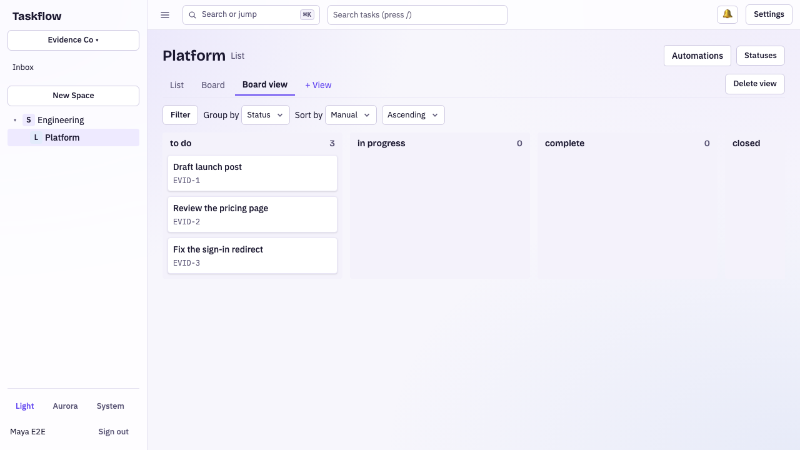
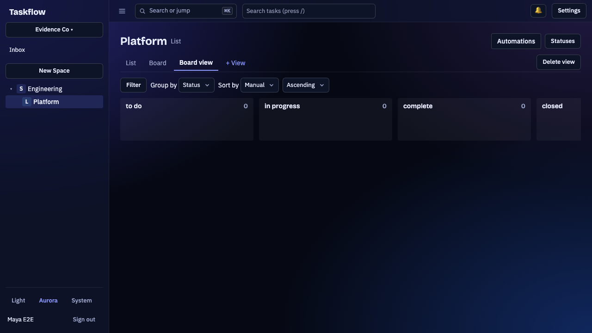
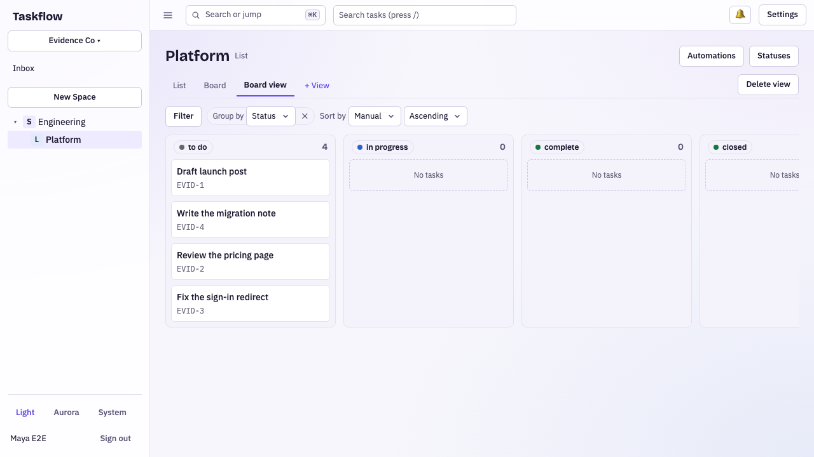
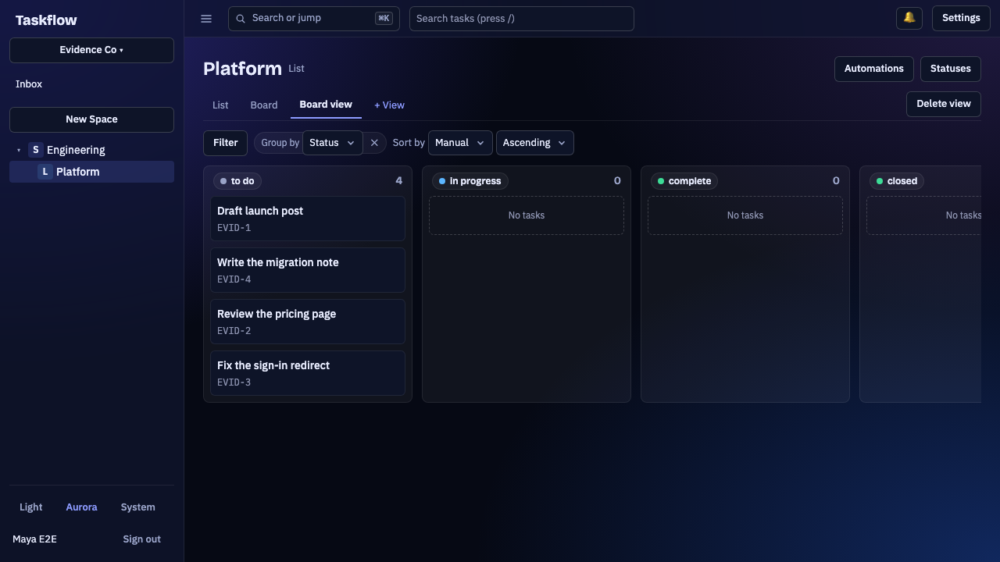
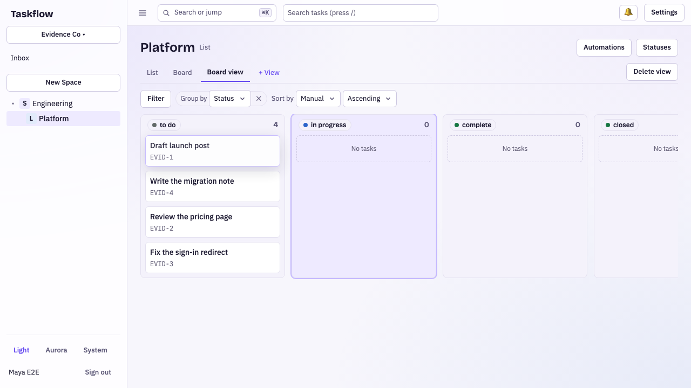
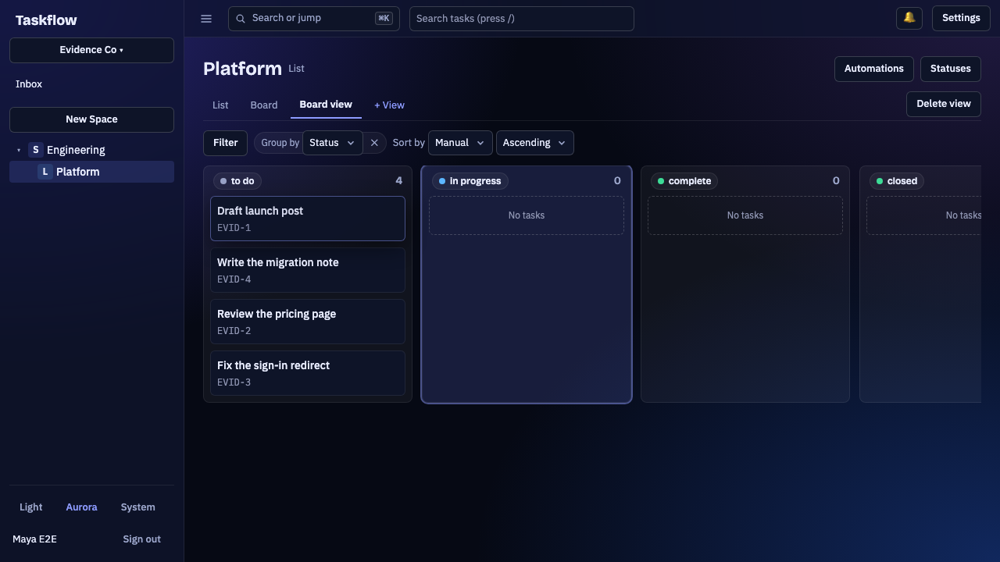

# Slice 6 report: the Board

Slice 6 changes `frontend/`, `scripts/` and `docs/ui/` only: no API, no schema, no backend file, no new dependency. It
rebuilds the Board view (UI-PRD section 8, the item after "task detail") on the Phase 3.5 tokens and library, and closes
the three slice-5 review carry-overs.

## What changed
- **Board (S4 to S7).** `BoardRenderer` is split into `BoardRenderer` (DndContext, columns, Board-level notices),
  `BoardColumn` and `BoardCard`. The identity contract is unchanged: `<section aria-label={label}>` per column, droppable
  `col:<key>`, sortable `<key>|<taskId>`, `data-task-id` on the focusable card, so `focusRowOf` and the old e2e locators
  work as before.
  - Look: 268px columns on `bg-surface-2`, flat cards on `bg-surface` (no shadow at rest), the column title in the group's
    vocabulary (`StatusValue`, `PriorityValue` or the library `Avatar`), count right-aligned. Cards show the id, the Blocked
    badge, `PriorityValue` (not for NONE), `DayValue`, `AssigneesValue` and up to three field chips. `PRIORITY_CLASS`, the
    inline initials circle and the hand-styled Load more button are deleted; Load more is a library ghost `Button`.
    `ValueChip` and `OptionChip` (shared with List, Table and the field manager) moved to tokens.
  - States: a skeleton ("Loading the Board") while there is no column to draw; a library `ErrorState` with Retry for a
    failed lead query; "No tasks in this view." or the no-match notice; per column a skeleton, its own error whose Retry
    refetches only that column, and a dashed "No tasks" box that stays inside the droppable region.
  - Keyboard and drag: Space lifts and drops, Escape cancels, Enter on the focused card opens the task detail over the Board
    (dnd-kit's default start keys included Enter). Enter does nothing while any card is lifted (the detail would open with
    the sensor still live and a Space there would drop the card). The card is the single tab stop (the title link is
    `tabIndex=-1`). The column under a lifted card gets `data-over="true"` (accent-soft ground, accent-line outline); it is
    read from the over id because `over` is usually a card, not the column. The lifted card gets an accent border and the
    float shadow.
- **Carry-overs**, see the table below.

## Bundle size
`bash scripts/bundle-size.sh --check` after a fresh `npm run build`. Slice 5 ended at 445.0 KiB in its report; the main
branch measured 445.1 KiB at the start of this run.

| After | JS/CSS (gzip -9) | Delta |
|---|---|---|
| Start of the run (main) | 445.1 KiB | |
| S1 Script guard (`ed06038`) | 445.1 KiB | +0.0 |
| S2 Focus fix (`5981510`) | 445.1 KiB | +0.0 |
| S3 e2e (`69f93d3`) | 445.1 KiB | +0.0 |
| S4 Chips (`3d6a032`) | 445.1 KiB | +0.0 |
| S5 Board look (`4d014bb`) | 445.2 KiB | +0.1 |
| S6 States | 445.4 KiB | +0.2 |
| S7 Drag feedback and keys | 445.7 KiB | +0.3 |
| S8 (specs and docs only) | 445.7 KiB | +0.0 |

Result: `bundle-size: ok`, **445.7 of 446.3 KiB** (cap unchanged, `bundle-budget.json` untouched, option (a)); +0.6 KiB over the
start. S1 to S5 were measured one by one in slice 7 (a temporary worktree per commit, `npm ci`, `npm run build`,
`bash scripts/bundle-size.sh --check`; the start commit `7e1781e` measures 445.1 KiB). Every measured total matches the
rows above to within 0.1 KiB. 0.6 KiB is left, so the Table and Calendar rebuilds must delete the code they replace first.

## Contrast
axe `color-contrast`, zero violations, in Light and Aurora and under both OS schemes on `board` and `board-drag`
(`theme-screens.spec.ts`). No token changed.

## Screenshots (before | after)
`bash scripts/e2e-local.sh e2e/theme-screens.spec.ts`. Before is the committed slice-3 Board shot (the Board was untouched
since; it had a legacy look and no loading, empty or error state).

| Screen | Light | Dark (Aurora) |
|---|---|---|
| Board, before |  |  |
| Board, after |  |  |
| A card lifted, next column highlighted |  |  |

The after shots also show the column states: the empty "in progress", "complete" and "closed" columns carry the dashed
"No tasks" box. The seeded tasks have no priority, due day or assignee, so those parts of a card are covered by Vitest
(`BoardView.test.tsx`, "Board cards and column headers") and not by the screenshots. Loading and error states are covered
by Vitest, not by a screenshot.

## Carry-overs from slice 5
| Carry-over | Status |
|---|---|
| Docked -> modal put focus on the title instead of the Docked toggle | Fixed (S2): the body records the element it focused and the Dialog focuses that same one (`TaskPanel.test.tsx` "switching docked to modal leaves focus on the Docked toggle", failed before the fix; `task-detail.spec.ts` first test) |
| `task-detail.spec.ts` "survives a reload" did not reload after uncheck, renames, deletes | Fixed (S3): the test waits for each write and reloads after check, uncheck, item rename, checklist rename, item delete and checklist delete |
| `scripts/e2e-failures.mjs` entry guard failed for repo paths with spaces | Fixed (S1): `pathToFileURL(realpathSync(argv[1]))`; `scripts/e2e-failures.test.mjs` covers a spaced path and a symlink (macOS `/var`) |

## Legacy bridge
Dead-entry scan (`legacy-bridge-usage.test.ts`) passes. Removed entries: `--color-slate-900` (the chips), `--color-orange-100`,
`--color-orange-800`, `--color-blue-800` (the Board). No line was added to `legacy-bridge.css`.

## Native selects
None added.

## Deviations from the plan
- No `DragOverlay`: the dragged element itself is styled (accent border, float shadow, 90% opacity), because one element cannot
  be both the 50% placeholder and the lifted card and the bundle had 0.6 KiB left.
- The Board-level error keeps the columns when the statuses already gave them: the banner shows above them (the plan showed
  the error instead). A lead failure with no columns shows the error alone.
- The theme-screens drag shot and `board-dnd.spec.ts` use the helper `liftToNextColumn` (`e2e/helpers.ts`): dnd-kit's keyboard
  sensor listens for arrow keys one tick after Space, so a key pressed at once can be lost. Observed as 3 of 5 theme runs
  failing with the first, naive version.
- The BMAD documents named in the plan were not readable from the run folder; the plan itself was followed.
- The slice-5 token scan (`tokens-only.test.ts`) lists the Board files and the two chips.
- Known, pre-existing, not fixed: with assignee grouping a task with two assignees has two cards and focus return lands on the first.

## Flakes seen during this run
- `theme-screens.spec.ts` board-drag: failures described above, root cause the lost arrow key; fixed with the helper, then two
  clean runs with `--retries=0` and one clean full run. Load average was 5 to 50 on this machine (other processes) while the
  failures were seen, so the first "Picked up" wait was also checked against an idle machine (it failed there too: the live
  region had already moved on to "is over", a bug in the test, not load).
- Full `bash scripts/e2e-local.sh` on the final tree: 71 passed, "No failed attempts.".

## Tests
The full local PR check (secret scan, `node --test scripts/e2e-failures.test.mjs`, the script self-test, `gen:api` drift, lint,
typecheck, Vitest, build, `check:dist` and its self-test, bundle check and self-test, `bash scripts/e2e-local.sh`):
- Lint 0 errors (16 warnings, same kinds as before); typecheck clean; `gen:api` leaves `schema.d.ts` unchanged.
- Vitest: 94 files, 656 tests passed (new: focus on the toggle, card values, column header, six state cases, Enter/Space
  keys, drop target).
- Bundle: `ok`, 445.7 of 446.3 KiB.
- e2e (whole suite): 71 passed, "No failed attempts."; new: two keyboard tests in `board-dnd.spec.ts`, the reload-after-every-write
  checklist test, the docked -> modal focus step, the `board-drag` shots.
