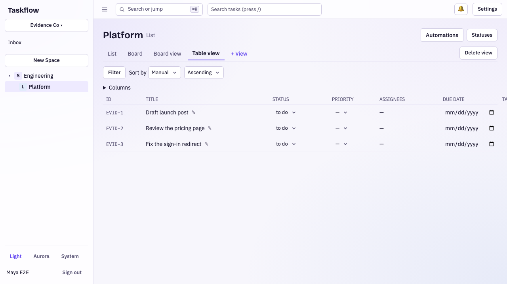
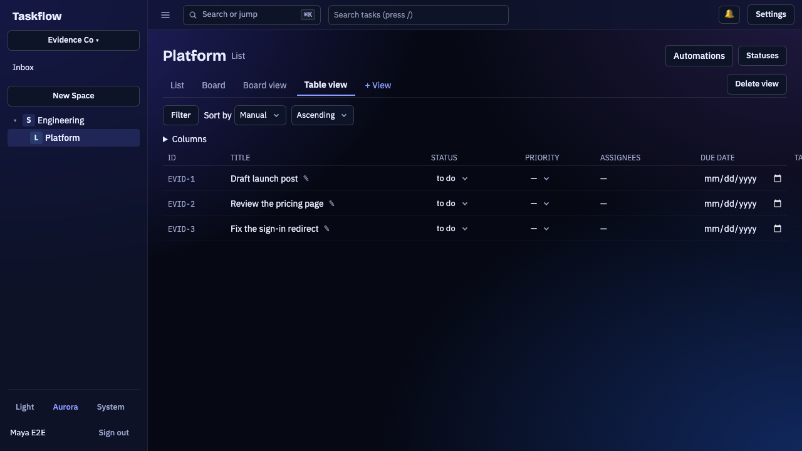
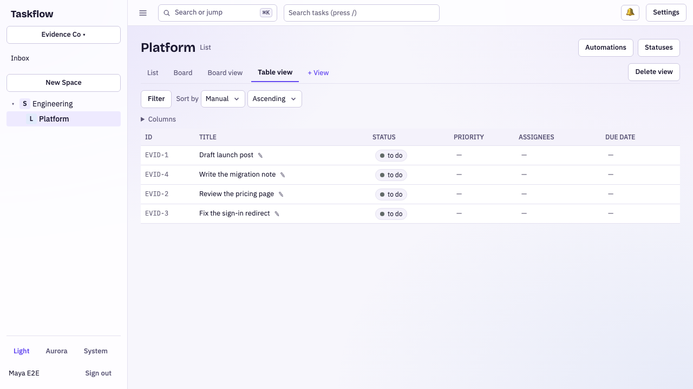
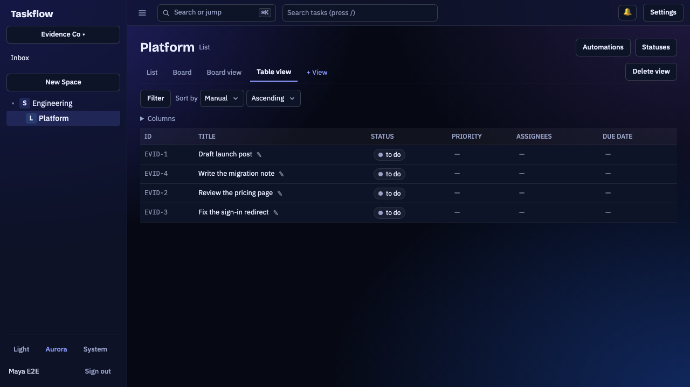
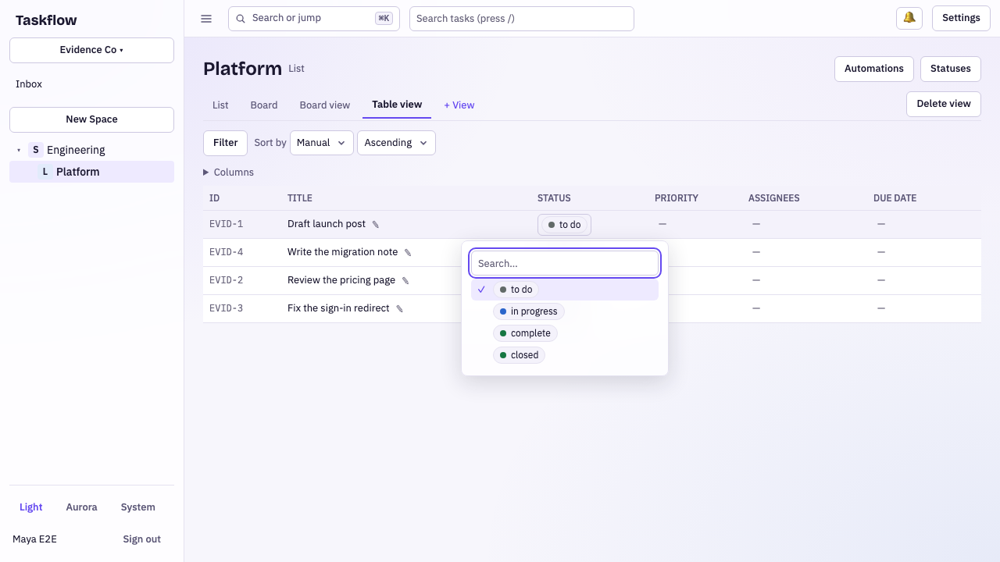
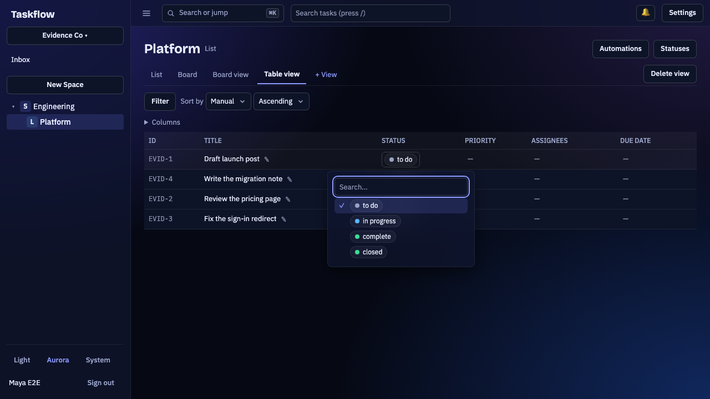

# Slice 7 report: the Table

Slice 7 changes `frontend/`, `scripts/` and `docs/ui/` only: no API, no schema, no backend file, no new dependency. It
rebuilds the Table view (UI-PRD section 8, the item after the Board) on the Phase 3.5 tokens and the List's Picker editors,
and closes the three slice-6 carry-overs.

## What changed
- **Editors (S1).** The Table edits status, priority, assignees, due and start with the List's `StatusEditor`,
  `PriorityEditor`, `AssigneeEditor` and a day editor shared by due and start (`DueEditor` keeps its names; `StartEditor` uses
  "Start date of X", "Set start date of X", "Start day of X"; only due can be overdue). `SelectCell`, `DateCell` and
  `MultiPickCell` are deleted (`cells.tsx` exports `EditableText` and `TagsCell`). A `TableRow` computes statuses, the done flag
  and member names once per row instead of once per cell, and clears the row's open editor when it unmounts (rows are virtualised).
- **Structure and look (S4).** The Table is an ARIA `table` named "Tasks table" (cells are `cell`, rows `tabIndex=-1` with
  `aria-rowindex` from 2, the header row is index 1, `aria-rowcount` is rows + 1 or -1 while more pages exist). The header is
  `sticky top-0 z-10` inside the one scroll container, so it scrolls sideways with the rows; header, rows wrapper and each row
  are as wide as the column sum. The rows wrapper starts below the in-flow header, so there is no `scrollMargin` and no
  header-high gap above the first row (the e2e asserts the first row's top equals the header's bottom). Rows are flat 36px
  rows on `bg-surface` with a `border-line` line; header labels are uppercase `text-muted` on `bg-surface-2`; the resize handle is
  transparent at rest, `line-strong` on header hover and `accent-line` while dragging or while its header button has focus.
  `cells.tsx` and `FieldCell.tsx` moved to tokens (the List shares them).
- **States (S5).** The real header with eight skeleton rows in a "Loading the Table" status; the library `ErrorState` with
  Retry; "No tasks in this view." or the no-match notice; a ghost Load more button, disabled while fetching.
- **Keyboard and focus (S6).** Alt+Arrow and Alt+Shift+Arrow on a header button are unchanged; the row is focusable
  (`tabIndex=-1`), so Escape on the task detail lands focus on that task's row.

## Bundle size
`bash scripts/bundle-size.sh --check` after a fresh `npm run build`. The start was measured on `041d661` before any change:
**445.7 KiB**, the same as slice 6's S8 row (the three review-fix commits after S8 left the total unchanged at one decimal).

| After | JS/CSS (gzip -9) | Delta |
|---|---|---|
| Start (`041d661`) | 445.7 KiB | |
| S1 Table cells use the List Pickers | 445.5 KiB | -0.2 |
| S2 (docs only) | 445.5 KiB | +0.0 |
| S3 FilterInput stable fallback (one constant) | 445.5 KiB (not re-measured alone: no code of note) | +0.0 |
| S4 Table on tokens, sticky header | 445.6 KiB | +0.1 |
| S5 States | 445.7 KiB | +0.1 |
| S6 Keyboard, tests | 445.7 KiB | +0.0 |
| S7 (spec and docs only) | 445.7 KiB | +0.0 |

Result: `bundle-size: ok`, **445.7 of 446.3 KiB**; cap and `bundle-budget.json` unchanged (option (a)). 0.6 KiB is left for
the Calendar. The Table-only editors freed 0.2 KiB; the states, the start editor and the structure used it back.

## Contrast
axe `color-contrast`, zero violations, in Light and Aurora and under both OS schemes on `table` and `table-edit`
(`theme-screens.spec.ts`). No token changed.

## Screenshots (before | after)
`E2E_SCREENSHOTS_DIR=docs/ui/slices/slice-7 bash scripts/e2e-local.sh e2e/theme-screens.spec.ts` (run from the repo root the
variable is relative to `frontend/`; the files were moved). Before is the committed slice-3 Table shot.

| Screen | Light | Dark (Aurora) |
|---|---|---|
| Table, before |  |  |
| Table, after |  |  |
| Status Picker open on a row |  |  |

Loading, empty and error states are covered by Vitest, not by a screenshot.

## Carry-overs from slice 6
| Carry-over | Status |
|---|---|
| Bundle: S1 to S5 not measured one by one | Done (S2): each commit built in a temporary worktree (`git worktree add`, `npm ci`, `npm run build`, `bash scripts/bundle-size.sh --check`, `git worktree remove`): `7e1781e` 445.1, `ed06038` 445.1, `5981510` 445.1, `69f93d3` 445.1, `3d6a032` 445.1, `4d014bb` 445.2 KiB. Matches the old rows within 0.1 |
| Bundle room for the Table | S1 freed 0.2 KiB by deleting `SelectCell`, `DateCell`, `MultiPickCell` |
| Review of 1cec827 (`ChoiceGroup`) | See the findings below |

### Findings of the 1cec827 review (S3)
| Finding | Outcome |
|---|---|
| `FilterInput` passed a fresh `[]` as `list` whenever the value was not an array, so `ChoiceGroup`'s sync effect ran on every such render and a parent re-render between two quick clicks reset `latest` and dropped the first pick | Fixed: a module constant `NO_VALUES`. New Vitest `FilterInput.test.tsx` "an undefined value followed by two quick clicks ... re-renders between them" failed before the fix |
| The only Vitest case covered a PEOPLE field and check-check | Fixed: new cases for a Dropdown option list with `any_of` (two quick checks), check-then-uncheck ending at `[]`, and unchecking keeping the order of the others |
| `fields-filters.spec.ts` value-entry waits for the editor to open and close | Sound, unchanged |
| The older step that clicks "Free" and expects it unchecked | Explained, not changed: `defaultValue` in `features/fields/filterOps.ts` preselects the first Dropdown option for `any_of`, so the click unchecks it |

## The e2e layout steps of the sticky header (S4)
`e2e/table.spec.ts` "layout", 30 tasks, a 900px-wide viewport: the first row's top equals the header's bottom before
scrolling; after scrolling down `elementFromPoint` at the header's centre is inside the header; scrolled to the end, the last
task's row is visible and below the header; scrolled to the far right, the header's and the first row's widths equal the
column sum and the last header cell is the element at its own centre.

## Legacy bridge
Dead-entry scan (`legacy-bridge-usage.test.ts`) passes. Removed entry: `--color-blue-300` (the resize handle). No line was
added to `legacy-bridge.css`.

## Native selects
None added; the Table's native date input and the Table-only select are gone.

## Deviations from the plan
- "The title column header cannot be dropped" (S6): the code lets the Title column be dragged like any other (only hiding it is
  blocked); the new Vitest case checks that a header dropped on itself leaves the order unchanged. The behaviour was not changed.
- S3 was not re-measured for the bundle on its own (one module constant in an already bundled file).
- No `scrollMargin`: the rows wrapper sits below the in-flow sticky header, which removes the need to offset the virtualiser
  (and the header-high gap risk). The overscan of 8 rows covers the 32px difference between the scroll offset and the wrapper.
- No Table row keys and no row selection, as the owner answered.
- The BMAD documents named in the plan were not read; the plan itself was followed.

## Flakes seen during this run
- `bash scripts/e2e-local.sh e2e/fields-filters.spec.ts --repeat-each=6`: first run (`uptime` load 4.59 / 5.50 / 5.50) 5 of 6
  passed. The one failure: after Beta's tier was picked, the click on "Story points: empty" put the tier cell back into its editor
  and the points were never typed (screenshot in `artifacts/e2e-failures/20261126-214938`; the Table was scrolled sideways).
  Second run (load 6.15 / 5.77 / 5.60): 6 of 6, "No failed attempts.". Machine load was 4 to 7 throughout, never idle, so
  the plan's 6 of 6 on an idle machine is **not** proven; the cause is unknown (a mis-click while the page scrolled sideways is the
  likely one) and should be watched.
- Full `bash scripts/e2e-local.sh` on the final tree (load 4.4 to 7.4): 73 passed, "No failed attempts.".
- `theme-screens.spec.ts` alone: 5 of 5 (load 4.8).

## Tests
The full local PR check (secret scan, `node --test scripts/e2e-failures.test.mjs`, the script self-test, `gen:api` drift, lint,
typecheck, Vitest, build, `check:dist` and its self-test, bundle check and self-test, `bash scripts/e2e-local.sh`) passed:
- Lint 0 errors (16 warnings, same kinds as before); typecheck clean; `gen:api` leaves `schema.d.ts` unchanged.
- Vitest: 95 files, 676 tests passed (new: start day, two assignees, one open editor, table structure and widths, five states,
  pointer resize, header drop, four `FilterInput` cases, start form names).
- Bundle: `ok`, 445.7 of 446.3 KiB.
- e2e (whole suite): 73 passed, "No failed attempts."; new: `table.spec.ts` (layout; Pickers, keyboard, reload, focus return),
  the `table-edit` shots.
